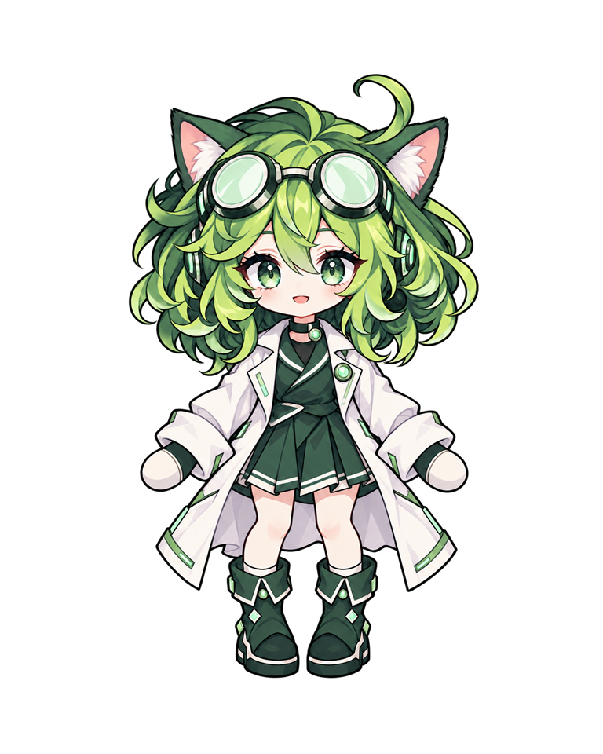

# CyberCat branding

CyberCat's detailed scientist mascot takes its layered green hair, mint goggles,
ivory coat with folded cuffs and lapels, trimmed pleats and decorated boots from
**Detailed Clover**. Green cat ears, green eyes and mint technology details keep
CyberCat recognizable within a coherent green identity. The wordmark is live
text for clear rendering in light and dark themes. Semantic success, warning and
error colors, terminal stderr/stdout colors and neutral surfaces remain unchanged.

## Primary palette

The UI primary is exactly the user-selected `#40c977` in both themes.
Hover is an 18% white tint, and active is a 12% black shade, rounded to RGB bytes.
Bright fills use dark green text for contrast. The saved
[character palette reference](source/palette-reference.json) documents the artwork
only; it does not determine the current UI primary.
`apps/web/src/brand-theme.ts` is the shared source of truth.

| Role | Light theme | Dark theme |
| --- | --- | --- |
| Primary fill | `#40c977` | `#40c977` |
| Primary hover / active | `#62d38f` / `#38b169` | `#62d38f` / `#38b169` |
| Primary button foreground | `#07381d` | `#07381d` |
| Brand text and links | `#137c40` | `#83e5aa` |
| Brand text hover / active | `#0f6634` / `#0b5129` | `#afefc6` / `#58d38b` |
| Subtle brand background | `#eefbf3` | `#11291b` |
| Brand border | `#ade7c1` | `#36764e` |
| System log text on the dark terminal | `#83e5aa` | `#83e5aa` |

Navigation, panel icons, headings, links, selected commands, Run buttons, loading
surfaces and streaming indicators all use this palette. A small theme algorithm
override preserves the exact primary in both themes. Only primary Button
foregrounds change; semantic danger foregrounds and status colors remain intact.
The current detailed green mascot and all source artwork remain unchanged.
Selected command descriptions use full-opacity text for readable contrast on all
three primary fill states.



| Asset | Use |
| --- | --- |
| `source/CyberCatDetailedGreen.png` | Current transparent ImageGen color-edit source |
| `source/CyberCatDetailed.png` | Preserved initial purple-accent source for rollback |
| `CyberCatDetailed.png` | Padded 768 x 960 full-body artwork for README and assistant empty state |
| `CyberCatDetailedAvatar.png` | 512 x 512 portrait for panel headers |
| `CyberCatDetailed.ico` | 16, 24, 32, 48, 64, 128 and 256 px browser/Windows icon |

The original `CyberCat.png`, `CyberCatWithName.png`, `CyberCat4Text.png`,
`CyberCat.ico` and web source favicon are preserved for review and rollback.

## References and generation

- Style reference: CyberKit's `pets/clover-detailed/clover.png`, read from the
  existing local checkout. [Reference commit](https://github.com/zixiCat/CyberKit/commit/469891df47213ca0988efd05b55caf205da33534)
  preserves Detailed and Simple Clover separately; only Detailed informed this art.
- Identity reference: this repository's original `brand/CyberCat.png`.
- Generated on 2026-10-22 with the built-in ImageGen tool, using both references
  and a transparent background. [Initial generation prompt](source/prompt.txt).
- Recolored with the built-in ImageGen tool from the saved CyberCat artwork and
  Detailed Clover's green palette. [Exact green-edit prompt](source/green-edit-prompt.txt).
  The saved initial source remains unchanged; exports now use the green source.
- CyberKit, both Clover designs and installed pet settings were not modified.

## Re-export

Run from the repository root on Windows:

```powershell
./brand/export-assets.ps1
```

The script uses System.Drawing to crop/scale the saved generated pixels and
package the icon. It does not generate or draw new character art. Webpack copies
the root brand PNGs and the new ICO; the Windows builder uses the same ICO.

## Integration files

| File | Change |
| --- | --- |
| `README.md` | Full-body mascot and brand documentation link |
| `apps/web/src/app/components/brand-title.tsx` | Shared portrait and theme-aware text wordmark |
| `apps/web/src/app/features/selection-assistant/selection-assistant-panel.tsx` | Full-body assistant empty state |
| `apps/web/src/brand.css` | Focused brand styles and narrow-screen layout |
| `apps/web/src/brand-theme.ts` | Shared green theme palette with accessible text/link colors |
| `apps/web/src/main.tsx` | Applies brand tokens and readable navigation accents |
| `apps/web/src/app/app.tsx` | Maps brand text and terminal accents to CSS variables |
| `apps/web/AGENTS.md` | Records the corrected green brand standard |
| `.github/instructions/web-ui.instructions.md` | Keeps the shared web instructions aligned with the approved palette |
| `apps/web/src/styles.css` | Imports brand styles and lays out the empty state |
| `apps/web/src/index.html` | New favicon reference |
| `apps/web/webpack.config.js` | Includes the new ICO in web/desktop builds |
| `apps/web/package.json` | Includes root brand PNG/ICO files in build cache inputs |
| `desktop/main.cjs` | Uses the new icon for the Electron window |
| `package.json` | Uses the new icon for Windows packaging |
| `apps/service/package.json`, `package-lock.json` | Synchronized 1.0.5 release version metadata |

The added brand files are the five artwork files in the asset table above,
this README, `export-assets.ps1`, `source/prompt.txt`, `source/green-edit-prompt.txt`,
and `source/palette-reference.json`.

## Validation

- Web production build, TypeScript checks and ESLint passed.
- Service build passed (cached); no service code changed.
- Browser review at the normal desktop viewport and 390 x 844: command filtering
  and selection, anchor navigation, theme changes, all brand image loads and no
  horizontal page overflow. Light and dark backgrounds were visually reviewed.
- ICO directory and all seven PNG frames checked; all three exported assets are
  present in the production web build. Original artwork files remain unchanged.
- Primary controls meet 6.18:1 contrast with their dark text (hover 7.05:1, active
  4.81:1). Brand text/links meet 5.27:1 on white and 12.07:1 on the dark panel;
  text hover/active states also exceed 4.5:1. Semantic success, warning, error,
  info and neutral surface tokens match the original algorithms.
- Windows x64 NSIS installer, blockmap and update metadata built for 1.0.5.
  The embedded installer payload passed 7-Zip integrity checks, and packaged
  branding assets match the approved files byte-for-byte. The package contains
  the repository's example environment file, not a private runtime environment.
- The packaged executable started with an isolated test profile. Its production
  UI loaded commands and streamed a harmless test script to exit code 0; light
  and dark theme checks confirmed the exact primary. The existing installed app
  and its workspace were left untouched. Installation over it was not tested.
- Both apps passed type checks and lint (three pre-existing service warnings).
  The Windows installer remains unsigned, matching previous releases.

Review screenshots are local, ignored outputs under `tmp/branding/`:
`primary-40c977-light.png`, `primary-40c977-dark.png`,
`primary-40c977-mobile-light.png`, and `primary-40c977-mobile-dark.png`.
